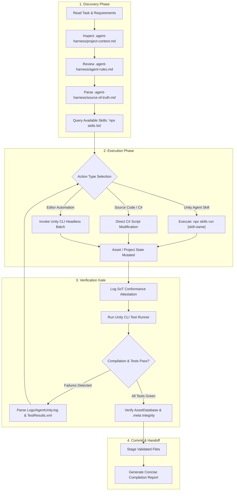
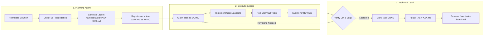

# Empress Project — AI Agent Harness

> **Mission**: Autonomous development harness for AI coding agents (Antigravity, Claude Code, GitHub Copilot, Cursor, Cline) driving the Empress 2D action-platformer via headless CLI automation, official agent skills, and rigorous verification gates.

---

## 1. System Architecture & Capabilities



### Core Capabilities
* **Headless Editor Control**: Directly invoke Unity 6 (`6000.3.10f1`) Editor in `-batchmode` without UI overhead.
* **Official Skills Ecosystem**: Integrated with [`Unity-Technologies/skills`](https://github.com/Unity-Technologies/skills) through the `npx skills` CLI.
* **Architecture Source of Truth**: Strict architectural governance via [`.agent-harness/source-of-truth.md`](file:///.agent-harness/source-of-truth.md) enforcing the Composition + EventBus pattern.
* **Multi-Agent Task Hand-off**: Decoupled planning, execution, and review cycles via [`.agent-harness/tasks-board.md`](file:///.agent-harness/tasks-board.md) and `.agent-harness/tasks/`.
* **Safe Asset Mutation**: No raw `.meta` or binary asset corruption; leverages Unity AssetDatabase and custom Editor batch methods.
* **Hermetic Verification**: Automated pre-commit verification gates (Compilation, EditMode, and PlayMode tests).

---

## 2. Workspace Isolation Map

```mermaid
flowchart LR
    subgraph HarnessIsolation[".agent-harness/ (Agent Harness Domain)"]
        direction TB
        H1["README.md (Entrypoint)"]
        H2["agent-rules.md (Boundaries & Governance)"]
        H3["source-of-truth.md (Architecture SoT)"]
        H4["task.template.md (Task Spec Blueprint)"]
        H5["project-context.md (Topology & Baseline)"]
        H6["tasks-board.md (Open Tasks Register)"]
        H7["tasks/ (Active Task Specifications)"]
        H8["bootstrap-harness.bat (Dependency Init)"]
    end

    subgraph UnityCore["Unity Project Core (Strict Engine Domain)"]
        direction TB
        U1["Assets/_Project/ (C# Scripts, Scenes, Prefabs, Art)"]
        U2["Packages/ (UPM Manifest & Dependencies)"]
        U3["ProjectSettings/ (Physics, Input, Tags)"]
        U4["Logs/ (Headless CLI Logs, Test Results)"]
    end

    HarnessIsolation -.->|Orchestrates via CLI / Skills| UnityCore
```



| Path | Ownership | Purpose |
| :--- | :--- | :--- |
| `.agent-harness/` | AI Agent & Automation | Harness configuration, operational rules, Source of Truth, bootstrap scripts |
| `.agent-harness/task.template.md` | AI Planning Agent | Standardized template cloned for all standalone tasks |
| `.agent-harness/tasks-board.md` | AI Swarm / Team | Central open tasks register tracking `TODO`, `DOING`, `REVIEW` states |
| `.agent-harness/tasks/` | AI Agents | Active standalone task specifications (`TASK-XXX-name.md`), auto-purged on `DONE` |
| `Assets/_Project/Source/` | Codebase | C# game code organized into Framework and Project layers with `.asmdef` assemblies |
| `Assets/_Project/Prefabs/` | Unity Engine | Hero, Boss, Projectiles, VFX, and Scene Settings prefabs |
| `Assets/_Project/Scenes/` | Unity Engine | BossScene (the current active scene) |
| `Assets/_Project/ScriptableObject/` | Data | HeroData.asset runtime data configuration |
| `Assets/Editor/AgentAutomation/` | Agent Tooling | Programmatic batch scripts for safe headless scene/prefab mutations |
| `Packages/` | Unity Package Manager | Project dependencies, scoped registries, and manifest |
| `ProjectSettings/` | Unity Engine Configuration | Engine settings, tag manager, graphics and physics matrices |
| `Logs/` | Ephemeral / Output | Unity batchmode logs (`AgentUnity.log`) and NUnit test reports (`TestResults.xml`) |

---

## 3. Unity CLI Integration Matrix

The harness executes Unity 6 (`6000.3.10f1`) without opening the GUI. All operations route through the Editor executable.

```powershell
# Standard Headless CLI Invocation Template (Windows)
& "C:\Program Files\Unity\Hub\Editor\6000.3.10f1\Editor\Unity.exe" `
  -batchmode `
  -nographics `
  -projectPath "." `
  -quit `
  -logFile "Logs/AgentUnity.log"
```

### Common CLI Command Patterns

| Operation | CLI Command Format |
| :--- | :--- |
| **Run EditMode Tests** | `"<UNITY_EDITOR_PATH>" -batchmode -nographics -projectPath "." -runTests -testPlatform editmode -testResults "Logs/EditMode-Results.xml" -logFile "Logs/TestRun.log"` |
| **Run PlayMode Tests** | `"<UNITY_EDITOR_PATH>" -batchmode -nographics -projectPath "." -runTests -testPlatform playmode -testResults "Logs/PlayMode-Results.xml" -logFile "Logs/TestRun.log"` |
| **Execute Batch Method** | `"<UNITY_EDITOR_PATH>" -batchmode -nographics -projectPath "." -executeMethod Namespace.ClassName.MethodName -quit -logFile "Logs/BatchExecute.log"` |
| **Recompile & Refresh** | `"<UNITY_EDITOR_PATH>" -batchmode -nographics -projectPath "." -quit -logFile "Logs/Recompile.log"` |

---

## 4. Unity Skills CLI Quick Reference

Leverage the official [`Unity-Technologies/skills`](https://github.com/Unity-Technologies/skills) pack:

```bash
# Verify or add the skills repository
npx skills add Unity-Technologies/skills

# List all loaded skills
npx skills list

# Run a specific skill prompt/workflow
npx skills run <skill-name>
```

---

## 5. Multi-Agent Task Hand-off & Lifecycle

Autonomous collaboration follows a strict hand-off contract managed through [`.agent-harness/tasks-board.md`](file:///.agent-harness/tasks-board.md) and `.agent-harness/tasks/`:



---

## 6. Agent Onboarding Checklist

1. **Bootstrap**: Execute `.agent-harness/bootstrap-harness.bat` (Windows) or `.agent-harness/bootstrap-harness.sh` (macOS/Linux).
2. **Read Rules**: Review [`.agent-harness/agent-rules.md`](file:///.agent-harness/agent-rules.md) for immutable boundaries and clarification protocols.
3. **Inspect Context & SoT**: Review [`.agent-harness/project-context.md`](file:///.agent-harness/project-context.md) and validate designs against [`.agent-harness/source-of-truth.md`](file:///.agent-harness/source-of-truth.md).
4. **Task Board Check**: Inspect [`.agent-harness/tasks-board.md`](file:///.agent-harness/tasks-board.md) to claim an open `TODO` task or register newly planned work.
5. **Attest & Execute**: State SoT conformance in logs, execute via skills/CLI, verify with automated tests, and stage clean commits.
6. **Hand-off & Context Update**: Move task to `REVIEW` (or delete if approved `DONE`) and update `project-context.md` if the broader architecture shifted.
