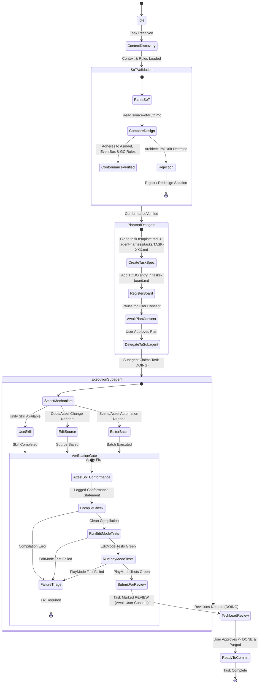
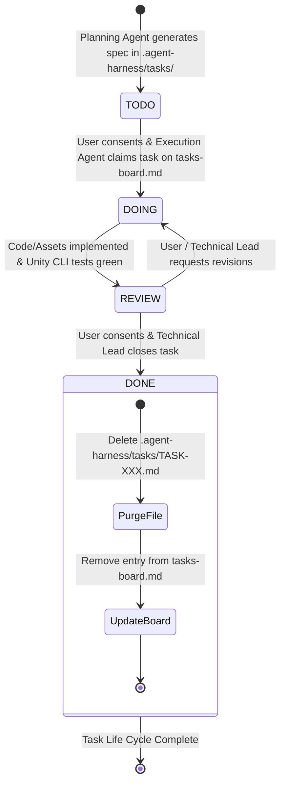

# Agent Operational Rules of Engagement

> **Status**: Active Policy  
> **Target Environment**: Unity 6 (`6000.3.10f1`) Editor CLI & Autonomous AI Coding Agents  
> **Project**: Empress — 2D Side-Scrolling Action-Platformer

---

## 1. Operational State Machine



---

## 2. Inviolable Rules

### Rule 1: Never Manually Hack `.meta` Files
* **Constraint**: Do **not** create, edit, or delete `.meta` files using arbitrary string manipulation or regex unless instructed.
* **Rationale**: Unity relies on 128-bit GUIDs and fileIDs within `.meta` files to maintain asset references across Scenes and Prefabs. Manual tampering corrupts the `AssetDatabase` cache and severs link chains.
* **Standard Operating Procedure**:
  - Add or modify raw `.cs` or asset files in `Assets/_Project/`.
  - Trigger a headless recompile:
    ```powershell
    & "C:\Program Files\Unity\Hub\Editor\6000.3.10f1\Editor\Unity.exe" -batchmode -nographics -projectPath "." -quit -logFile "Logs/Recompile.log"
    ```
  - Unity's `AssetDatabase` will deterministically generate valid `.meta` files.

### Rule 2: Mandatory Source of Truth (SoT) Validation Gate
* **Constraint**: Prior to creating or modifying any Unity asset, C# script, assembly definition, or scene configuration, the agent **MUST** parse `.agent-harness/source-of-truth.md` to validate the proposed implementation against established architectural rules.
* **Checks Required**:
  1. **Assembly Boundaries**: Ensure code resides within the correct `Com.Voobox.*` `.asmdef` layer (see SoT §2 for the complete dependency map).
  2. **Allocation Boundaries**: Verify zero heap allocations inside `Update()`, `FixedUpdate()`, or `LateUpdate()`.
  3. **Event Architecture**: Use the `EventBus` (static publish/subscribe via `IEvent` structs) for cross-entity mediation. Components operate locally via constructor-injected data interfaces.
  4. **Composition Pattern**: New entity behavior must follow the Composer → Component → Data pattern. No monolithic MonoBehaviour scripts combining data, logic, and presentation.

### Rule 3: Explicit SoT Conformance Attestation
* **Constraint**: The agent **MUST** explicitly state in its task execution logs how the planned changes conform to the Source of Truth *before* invoking verification tests via the Unity CLI.
* **Log Attestation Template**:
  ```markdown
  ### Source of Truth Conformance Attestation
  * Assembly / Layer: [e.g. Com.Voobox.Project.Component — local behavior logic for an entity]
  * Composition: [e.g. New XyzComponent is a plain C# class, injected into AbcComposer via constructor with IXyzData]
  * Event Pattern: [e.g. Cross-entity coordination via EventBus.Notify<SomeEvent>() / EventBus.Subscribe<SomeEvent>()]
  * Memory & GC: [e.g. Cached references in Awake(), zero allocations in Update(), Animator hashes via StringToHash()]
  ```

### Rule 4: Query and Leverage `Unity-Technologies/skills`
* **Constraint**: Prefer official Unity agent skills over reinventing custom scripts or manual configurations.
* **Standard Operating Procedure**:
  - Check available skills:
    ```bash
    npx skills list
    ```
  - Search or add the official skill pack:
    ```bash
    npx skills add Unity-Technologies/skills
    ```
  - Execute designated skills for targeted Unity tasks:
    ```bash
    npx skills run <skill-name>
    ```

### Rule 5: Mandatory Pre-Completion Test Gate
* **Constraint**: A task is **NEVER** marked complete until all associated tests pass cleanly via the Unity CLI test runner.
* **Test Creation Constraint**: Do not write tests that involve calls to a coroutine or UniTask.
* **Test Invocation Protocol**:
  1. **EditMode Tests**:
     ```powershell
     & "C:\Program Files\Unity\Hub\Editor\6000.3.10f1\Editor\Unity.exe" -batchmode -nographics -projectPath "." `
       -runTests -testPlatform editmode `
       -testResults "Logs/EditMode-Results.xml" `
       -logFile "Logs/EditMode.log"
     ```
  2. **PlayMode Tests**:
     ```powershell
     & "C:\Program Files\Unity\Hub\Editor\6000.3.10f1\Editor\Unity.exe" -batchmode -nographics -projectPath "." `
       -runTests -testPlatform playmode `
       -testResults "Logs/PlayMode-Results.xml" `
       -logFile "Logs/PlayMode.log"
     ```
  3. **Result Validation**:
     - Check CLI exit codes (0 = Success, 2 = Tests Failed, 3 = Run Cancelled).
     - Inspect `Logs/EditMode-Results.xml` for `<test-case result="Failed">`.

### Rule 6: Headless Scene and Prefab Modification
* **Constraint**: Avoid raw text search-and-replace on YAML `.unity` and `.prefab` files for structural edits.
* **Standard Operating Procedure**:
  - Implement an editor utility method under `Assets/Editor/AgentAutomation/`.
  - Use official Unity APIs (`PrefabUtility`, `EditorSceneManager`, `Undo`).
  - Execute via CLI batch method:
    ```powershell
    & "C:\Program Files\Unity\Hub\Editor\6000.3.10f1\Editor\Unity.exe" -batchmode -nographics -projectPath "." `
      -executeMethod AgentAutomation.SceneOps.ConfigureScene `
      -quit -logFile "Logs/SceneOp.log"
    ```
  - Delete temporary automation scripts after execution if they are one-off migrations.

### Rule 7: Log Parsing and Diagnostics
* Always capture and review `-logFile Logs/AgentUnity.log`.
* On failure, search the log file for:
  - `error CS`: C# compilation errors.
  - `Exception:` / `NullReferenceException:`: Runtime and Editor exceptions.
  - `Assertion failed`: Failed unit assertions.
* Do not hide or suppress CLI output; ensure failures are diagnosed before attempting subsequent passes.

### Rule 8: Harness Configuration Immutability
* **Constraint**: Agents must **NEVER** modify core harness configuration files (`agent-rules.md`, `README.md`, `source-of-truth.md`, `task.template.md`, `project-context.md`, or bootstrap scripts) unless explicitly, strictly, and unambiguously instructed to do so by the user's prompt.
* **Standard Operating Procedure**: Work within the designated engine folders (`Assets/_Project/`, `Packages/`, `ProjectSettings/`) or task tracking artifacts (`.agent-harness/tasks/`, `.agent-harness/tasks-board.md`).

### Rule 9: Ambiguity & Clarification Protocol
* **Constraint**: Whenever requirements are ambiguous, context is missing, or specifications admit multiple conflicting interpretations, the agent **MUST STOP** execution immediately.
* **Standard Operating Procedure**:
  - Do **not** guess or make arbitrary design assumptions that could compromise architecture or asset integrity.
  - Present the exact ambiguity or decision trade-offs to the user and await explicit clarification before modifying any Unity assets, scripts, or scene structures.

### Rule 10: Living Context Maintenance
* **Constraint**: Upon successful completion and verification of any task, the agent must evaluate whether its modifications alter the broader architectural topology, component dependencies, engine baseline, or global project state.
* **Standard Operating Procedure**:
  - If changes impact project landscape, update [`.agent-harness/project-context.md`](file:///.agent-harness/project-context.md) (and the active Source of Truth, if applicable) to reflect current project reality before final task closeout.

### Rule 11: Mandatory Plan-Then-Delegate Protocol (with User Approval Gates)
* **Constraint**: For any implementation task (creating or modifying C# scripts, `.asmdef` files, Unity assets, prefabs, scenes, or packages), the primary agent **MUST** act strictly as **Planning Agent & Technical Lead** and **MUST NOT** edit `Assets/` or `Packages/` directly in its own context. Both **plan execution** (`TODO` → `DOING`) and **final completion** (`REVIEW` → `DONE`) require explicit user consent.
* **Exemptions**: Read-only Q&A, codebase research, or explicit user instructions to execute directly without delegation.
* **Standard Operating Procedure**:
  1. **Plan**: Resolve all target file paths upfront and validate the design against [`.agent-harness/source-of-truth.md`](file:///.agent-harness/source-of-truth.md).
  2. **Specify & Register (`TODO`)**: Clone [`.agent-harness/task.template.md`](file:///.agent-harness/task.template.md) into `.agent-harness/tasks/TASK-XXX-<name>.md` and register it on [`.agent-harness/tasks-board.md`](file:///.agent-harness/tasks-board.md) as `TODO`.
  3. **Gate 1 — Pause for User Plan Consent**: Present the planned `TASK-XXX-<name>.md` to the user and **pause**. Do **not** delegate or start execution (`DOING`) until the user explicitly consents.
  4. **Delegate (`DOING` → `REVIEW`)**: Upon user consent, spawn an Execution subagent (e.g., via `invoke_subagent`) with the task specification path as its assignment. The Execution subagent claims the task (`DOING`), implements changes, logs the SoT Conformance Attestation, runs the Unity CLI test gates, and moves the task to `REVIEW`.
  5. **Gate 2 — Pause for User Review & Consent (`REVIEW` → `DONE`)**: Verify the diff, SoT attestation, and test results (`Logs/*-Results.xml`), present the `REVIEW` summary to the user, and **pause**. Wait for explicit user review and consent before marking `DONE`, purging `TASK-XXX-<name>.md`, and removing its row from `tasks-board.md`.

---

## 3. Multi-Agent Task Planning & Hand-off System



### 1. Planning Output Standard & Mandatory Template Usage
* **Mandatory Template Cloning**: Every new task file created inside `.agent-harness/tasks/` (e.g., `TASK-001-hero-health.md`) **MUST** be cloned directly from [`.agent-harness/task.template.md`](file:///.agent-harness/task.template.md).
* **Upfront Path Resolution**: The planning agent **MUST** resolve and populate all exact file paths (both existing files to modify and new files/assets to create) during the planning phase. The execution agent must never waste tokens or context searching the repository for target files.
* **Autonomous Execution Contract**: The task specification must contain:
  1. Header metadata with explicit Unity version (`6000.3.10f1`) and platform target.
  2. Concise 1-2 sentence objective.
  3. Concrete target file paths resolved upfront.
  4. Specific architectural constraints lifted from `source-of-truth.md`.
  5. Exact step-by-step Unity CLI commands and test runner parameters.
  6. Clear Definition of Done checklist.
* Any subsequent Execution Agent must be able to execute the task strictly from this document without requiring external chat history.

### 2. Four Strict Task Lifecycle Statuses
1. **`TODO`**: Task specification is generated, registered on `tasks-board.md`, and waiting to be claimed.
2. **`DOING`**: Execution Agent has claimed the task and is actively editing assets, C# scripts, or executing batch tools.
3. **`REVIEW`**: Implementation is complete, all Unity CLI tests (EditMode/PlayMode) pass cleanly, and the task is awaiting Technical Lead review.
4. **`DONE`**: Technical Lead has reviewed diffs and test results and approved the change.

### 3. Central Tracking Table Maintenance
* All active tasks must be registered in the central tracking table in [`.agent-harness/tasks-board.md`](file:///.agent-harness/tasks-board.md) with columns: `ID`, `Task Name`, `Status`, and `File Path`.
* The board reflects only live tasks (`TODO`, `DOING`, `REVIEW`).

### 4. Cleanup Rule
* Upon transitioning a task to **`DONE`**:
  - The task row must be removed immediately from `tasks-board.md`.
  - The corresponding specification file in `.agent-harness/tasks/` must be deleted.
  - The working tree remains clean, avoiding token bloating and repository clutter.
