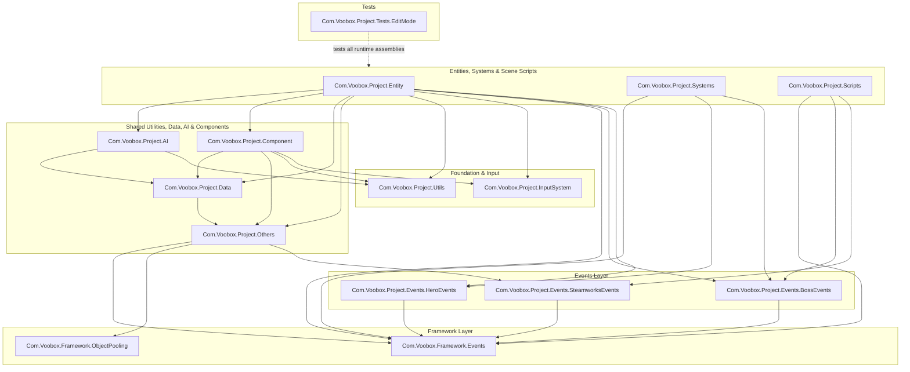

> **Human-Only Visual Reference**: AI agents skip this file (equivalent dependency matrix lives in [assembly-boundaries.md](../architecture/assembly-boundaries.md)).

# Assembly Definitions (`.asmdef`) Dependency Graph

