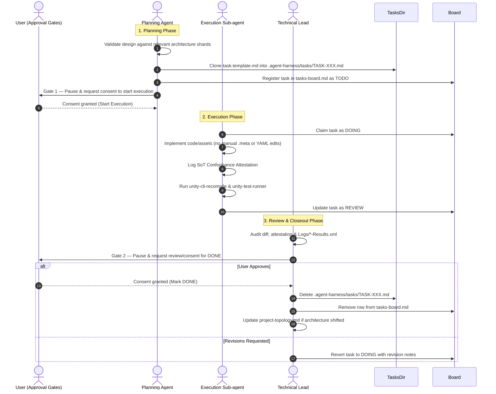
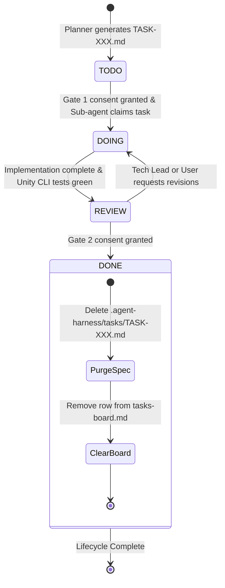

> **Human-Only Visual Reference**: AI agents skip this file (compact workflows live in [plan-task.md](../workflows/plan-task.md), [execute-task.md](../workflows/execute-task.md), and [review-and-closeout.md](../workflows/review-and-closeout.md)).

# Multi-Agent Task Lifecycle & State Machine

## Hand-off Sequence

## Task State Transitions

