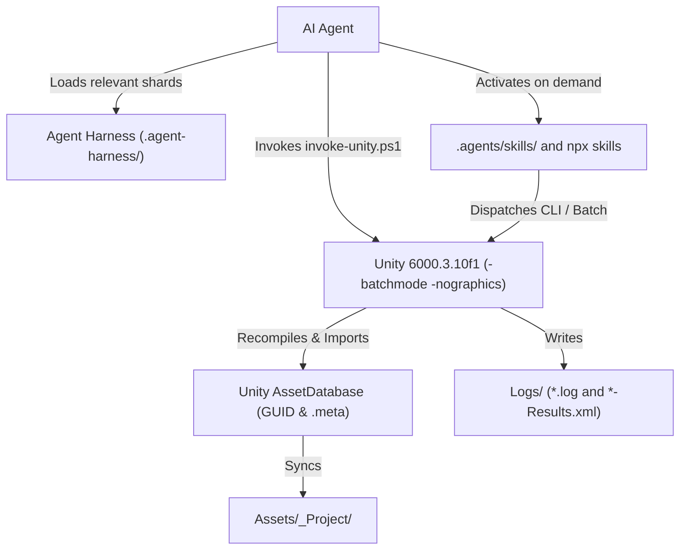
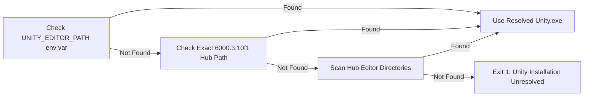

> **Human-Only Visual Reference**: AI agents skip this file (equivalent tables live in [project-topology.md](../architecture/project-topology.md)).

# Workspace Isolation & CLI Topology

## Workspace Isolation Map

```mermaid
flowchart LR
    subgraph HarnessDomain[".agent-harness/ and .agents/ (Agent Domain)"]
        direction TB
        A0["AGENTS.md (Always-On Router)"]
        A1["architecture/ (Domain Shards)"]
        A2["rules/ (Role-Scoped Rules)"]
        A3["workflows/ (Phase Procedures)"]
        A4["tasks-board.md and tasks/"]
        A5["scripts/ (invoke-unity.ps1, bootstrap)"]
        A6[".agents/skills/ (On-Demand Runbooks)"]
    end

    subgraph UnityCore["Unity Project Core (Engine Domain)"]
        direction TB
        U1["Assets/_Project/ (Scripts, Scenes, Prefabs, Data)"]
        U2["Assets/Editor/AgentAutomation/"]
        U3["Assets/Tests/EditMode/"]
        U4["Packages/ and ProjectSettings/"]
        U5["Logs/ (CLI Logs and Test XML)"]
    end

    HarnessDomain -.->|"Orchestrates via Unity CLI and Skills"| UnityCore
```

## Agent-to-AssetDatabase Execution Flow

## Unity Executable Resolution Order

