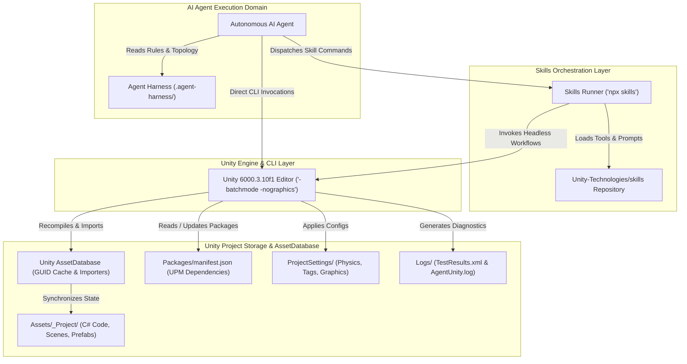
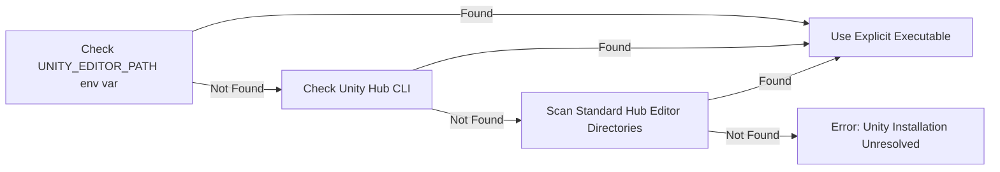

# Empress Project — Context & Technical Topology

> **Version**: 1.0.0  
> **Engine Baseline**: Unity 6 (`6000.3.10f1`)  
> **Project**: Empress — 2D Side-Scrolling Action-Platformer  
> **Architecture**: Composition + Event-Driven Mediation (Custom ECS-Inspired)

---

## 1. System Component Relationships

---

## 2. Technical Profile & Runtime Targets

| Attribute | Specification | Notes |
| :--- | :--- | :--- |
| **Engine Version** | `6000.3.10f1` | Unity 6 LTS |
| **Scripting Backend** | `CoreCLR` / `.NET 8` | Modern C# 12 language features supported |
| **API Compatibility** | `.NET Standard 2.1` / `.NET Framework` | High cross-platform portability |
| **Render Pipeline** | `Universal Render Pipeline (URP) 17.3.0` | 2D renderer for the side-scrolling platformer |
| **Primary Platform Target** | `StandaloneWindows64` | Host development platform |
| **Audio System** | `FMOD` (via plugin at `Assets/Plugins/FMOD/`) | Event-based audio with `StudioEventEmitter` |
| **Async Framework** | `UniTask` (Cysharp) | Zero-allocation async/await; replaces coroutines |
| **Input System** | `Unity Input System 1.18.0` | Generated `InputSystemActions` with Player action map |
| **Camera** | `Cinemachine 3.1.6` | `CinemachinePositionComposer` for target offset, `CinemachineImpulseSource` for screen shake |
| **Asset Loading** | `Addressables 2.9.1` | Async asset loading and pooling via `AssetReferenceGameObject` |
| **Steamworks** | `Facepunch.Steamworks` (via DLL) | Steam client integration (app ID 480 for testing) |

---

## 3. Environment Variable Mapping

The agent and local scripts resolve Unity through the following precedence order:

| Environment Variable | Resolved Path (This Machine) |
| :--- | :--- |
| `UNITY_EDITOR_PATH` | `C:\Program Files\Unity\Hub\Editor\6000.3.10f1\Editor\Unity.exe` |

---

## 4. Package Dependencies (Key Packages)

| Package | Version | Purpose |
| :--- | :--- | :--- |
| `com.cysharp.unitask` | Git (latest) | Zero-allocation async/await |
| `com.unity.inputsystem` | 1.18.0 | Player input (Move, Jump, Dash, Attack) |
| `com.unity.cinemachine` | 3.1.6 | Camera follow, screen shake, impulse |
| `com.unity.addressables` | 2.9.1 | Async asset loading, object pooling keys |
| `com.unity.render-pipelines.universal` | 17.3.0 | URP 2D rendering |
| `com.unity.2d.animation` | 13.0.4 | Sprite sheet animation |
| `com.unity.2d.aseprite` | 3.0.1 | Aseprite file import |
| `com.unity.test-framework` | 1.6.0 | NUnit test runner for EditMode/PlayMode |
| `com.unity.timeline` | 1.8.10 | Timeline for cutscenes/sequences |
| `com.abzorba.artificetoolkit` | Git (latest) | `[InlineObject]`, `[FoldoutGroup]` inspector attributes |
| `com.mackysoft.serializereference-extensions` | Git (latest) | SerializeReference polymorphic serialization |
| `com.wooshii.hierarchydecorator` | Git (latest) | Hierarchy window visual organization |
| FMOD Unity Plugin | Bundled (`Assets/Plugins/FMOD/`) | Sound effects and music |
| Facepunch.Steamworks | Bundled DLL | Steam platform integration |

---

## 5. Current Feature Inventory

### Hero (Player Character)
| Feature | Status | Key Files |
| :--- | :--- | :--- |
| **Horizontal Movement** | ✅ Implemented | `HeroComposer.Run()` → `Movement2DComponent.Run()` |
| **Jump (with buffer)** | ✅ Implemented | `HeroComposer.TryJump()` → `Movement2DComponent.Jump()` |
| **Jump Cut (variable height)** | ✅ Implemented | `HeroComposer.JumpCut()` → `Movement2DComponent.JumpCut()` |
| **Pogo Jump (downward attack)** | ✅ Implemented | `HeroComposer.PogoJump()` → `Movement2DComponent.PogoJump()` |
| **Dash** | ✅ Implemented | `HeroComposer.Dash()` → `DasherComponent.Dash()` |
| **Directional Attack (4-way)** | ✅ Implemented | `HeroComposer.HandleAttack()` → `AttackerComponent.Attack{Up/Down/Left/Right}()` |
| **Attack Recoil** | ✅ Implemented | `HeroComposer.Recoil()` → `Movement2DComponent.Recoil()` |
| **Hit Stop (Frame Freeze)** | ✅ Implemented | `HeroComposer.DoHitStop()` → `FrameFreezerComponent.Freeze()` |
| **Screen Shake** | ✅ Implemented | `ScreenShakerComponent.ShakeDirection()` / `GenerateImpulse()` |
| **Camera Follow with Offset** | ✅ Implemented | `ScreenShakerComponent.StabilizeTargetOffset()` / `FlipTargetOffsetX()` |
| **Sprite Flip** | ✅ Implemented | `HeroAnimatorComponent.FlipX()` |
| **Ghost/Invincibility Frames** | ✅ Implemented | `HeroComposer.GhostTimeTask()` (3 second i-frames) |
| **Damage/Knockback** | ✅ Implemented | `HeroComposer.TakeDamage()` → `Knockback()` |
| **Run Particles** | ✅ Implemented | `HeroComposer.HandleRunParticles()` |
| **Jump/Land Particles** | ✅ Implemented | Particle system refs in `HeroComposer` |
| **Animations** | ✅ Implemented | `HeroAnimatorComponent` (Speed, Grounded, Dash, AirVelocity, Attack, Ghost) |
| **SFX (Run, Jump, Dash, Attack)** | ✅ Implemented | FMOD `StudioEventEmitter` and `RuntimeManager.PlayOneShot()` |
| **Health System** | ❌ Not Implemented | No HP tracking, death, or respawn logic |

### Boss
| Feature | Status | Key Files |
| :--- | :--- | :--- |
| **Boss Initialization** | ✅ Implemented | `BossSceneScript` → `InitializeBossEvent` → `BossComposer` |
| **Raise of Swords Attack** | ✅ Implemented | `BossComposer` → `DoRaiseOfSwordsEvent` → `BossAttackEmitter` |
| **Boss Data** | 🟡 Stub Only | `BossData.cs` is empty; `BossDataScriptableObject` exists |
| **Boss Health / Damage** | ❌ Not Implemented | — |
| **Boss AI / State Machine** | ❌ Not Implemented | — |
| **Additional Attack Patterns** | ❌ Not Implemented | — |

### Framework / Infrastructure
| Feature | Status | Key Files |
| :--- | :--- | :--- |
| **EventBus** | ✅ Implemented | `EventBus.cs` — static pub/sub with `IEvent` |
| **Object Pooling (Addressables)** | ✅ Implemented | `ObjectPooler`, `PooledObject`, `ReturnToPoolBehaviour` |
| **VFX Impact Spawning** | ✅ Implemented | `AttackArea.CallVfxImpact()` → `ObjectPooler.Spawn()` |
| **Steamworks Integration** | ✅ Implemented | `BossSceneScript` init, `PlaceSteamName` display |

### Scenes
| Scene | Purpose |
| :--- | :--- |
| `MainMenuScene.unity` | Main screen UI with placeholder splash image and START button loading `BossScene` |
| `BossScene.unity` | Boss fight arena with Hero, Boss, camera, lighting, stage |
| `GameOverScene.unity` | Game over UI with `"Continue?"` TextMeshPro prompt and `"Yes"` (`BossScene`) / `"No"` (`MainMenuScene`) buttons |

---

## 6. Key Directory Anchor Points

* `Assets/_Project/Source/`: Primary C# gameplay and domain logic, organized by architectural layer.
* `Assets/_Project/Source/Framework/`: Shared infrastructure (EventBus, ObjectPooling) — no project-specific dependencies.
* `Assets/_Project/Source/Project/`: Game-specific code split into Component, Data, Entity, Events, Others, Scripts, Utils.
* `Assets/_Project/Prefabs/Units/`: Hero and Boss prefabs.
* `Assets/_Project/ScriptableObject/`: Runtime data assets (`HeroData.asset`).
* `Assets/_Project/InputSystem/`: Generated Input System action maps.
* `Assets/Editor/AgentAutomation/`: Programmatic batch scripts for safe headless scene/prefab mutations.
* `Assets/Tests/EditMode/`: NUnit EditMode unit test fixtures.
* `Assets/Tests/PlayMode/`: NUnit PlayMode integration test fixtures.
* `Logs/`: Dedicated ephemeral log output for headless runs (`AgentUnity.log`, `TestResults.xml`).
