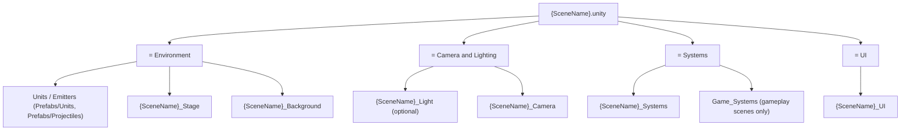

# Scene Hierarchy Standard — Empress Project

> **Authority**: Mandatory structural standard for every gameplay/UI scene in `Assets/_Project/Scenes/`  
> **Status**: Active Standard  
> **Target Engine**: Unity 6 (`6000.3.10f1`)  
> **Derived From**: Audit of `MainMenuScene`, `BossScene`, `GameOverScene`, `VictoryScene` (see §8)

---

## 1. Principles

1. **Fixed skeleton** — Every scene has the same four root separators, in the same order, even when a group is empty.
2. **Prefabs only** — Separators contain **only prefab instances**. No loose GameObjects at the scene root or directly under a separator. All scene content is authored inside prefabs so it can be diffed, reused, and edited headlessly.
3. **One prefab per role** — Each scene splits its content into role prefabs (`_Camera`, `_Light`, `_Systems`, `_UI`, `_Stage`, `_Background`) stored in `Assets/_Project/Prefabs/SceneSettings/`.
4. **Names mirror assets** — A prefab instance's name in the hierarchy is identical to its prefab asset file name. Do not rename instances.

---

## 2. Root Skeleton (Mandatory)



| Order | Separator Name (exact) | Purpose |
| :---: | :--- | :--- |
| 1 | `= Environment` | Everything that lives in world space: units, attack emitters, stage geometry/colliders, backgrounds |
| 2 | `= Camera and Lighting` | Render camera, Cinemachine rig, camera bounds, URP 2D global light and post-processing volume |
| 3 | `= Systems` | Non-visual scene orchestration and services (scene scripts, object pooling, game/pause controllers) |
| 4 | `= UI` | Screen-space Canvas(es) and the `EventSystem` |

### 2.1 Separator Object Rules
* **Name**: Exactly as listed above — `=` prefix, one space, Title Case words, **no trailing whitespace**. The `=` prefix is consumed by HierarchyDecorator (`Assets/HierarchyDecorator/Settings.asset`, style *Header (Centered)*).
* **Components**: `Transform` only. No scripts, renderers, or colliders.
* **Transform**: Identity (position `0,0,0`, rotation identity, scale `1,1,1`) so children keep their authored world positions.
* **Tag / Layer**: `Untagged` / `Default`. **Active**: `true`.
* **Always present**: Keep all four separators even when empty (e.g. `= UI` in `BossScene` until a HUD exists).
* **Reserved prefixes**: `-` (*Subheader*) and `+` (*Mini Header*) are reserved for sub-grouping **inside** prefabs if ever needed; never use them at scene root.

---

## 3. Group Contents & Ordering

Children are listed in the order they must appear under each separator. Rows marked *optional* may be omitted when the scene doesn't need them.

### 3.1 `= Environment`
| Order | Child | Source | Required |
| :---: | :--- | :--- | :--- |
| 1 | Entities: units and emitters (e.g. `Hero`, `Boss`, `BossAttackEmitter`) | `Prefabs/Units/`, `Prefabs/Projectiles/` | Gameplay scenes |
| 2 | `{SceneName}_Stage` — playable area sprite + boundary/ground colliders | `Prefabs/SceneSettings/` | Gameplay scenes |
| 3 | `{SceneName}_Background` — parallax/sprite layers (`Layer_1..N`) | `Prefabs/SceneSettings/` | Optional |

* Pooled runtime objects (projectiles, VFX) are **never** placed in the scene; they are spawned by `ObjectPooler`.

### 3.2 `= Camera and Lighting`
| Order | Child | Contents | Required |
| :---: | :--- | :--- | :--- |
| 1 | `{SceneName}_Light` | `Global Light 2D` (Light2D), `Global Volume` (Volume) | Optional (required when the scene renders lit 2D sprites) |
| 2 | `{SceneName}_Camera` | `MainCamera` (+ optional `CinemachineCamera`, `CameraBounds`) | Always |

**Camera prefab internals**:
```text
{SceneName}_Camera
├── MainCamera          Camera, UniversalAdditionalCameraData, [CinemachineBrain], exactly one listener
├── CinemachineCamera   (optional) CinemachineCamera, PositionComposer, Confiner2D, ImpulseListener…
└── CameraBounds        (optional) BoxCollider2D used by the Cinemachine confiner
```
* Child camera GameObject is named `MainCamera` (no space) and tagged `MainCamera`.
* Exactly **one** audio listener per scene, on `MainCamera`. Scenes that play FMOD events use FMOD `StudioListener` instead of Unity `AudioListener`.

### 3.3 `= Systems`
| Order | Child | Contents | Required |
| :---: | :--- | :--- | :--- |
| 1 | `{SceneName}_Systems` | `{SceneName}Script` (scene lifecycle orchestration, `Com.Voobox.Project.Scripts`) + scene-scoped services | Always |
| 2 | `Game_Systems` | `GameScript`, `PauseController` (shared cross-scene prefab) | Gameplay scenes only |

**`{SceneName}_Systems` internals**:
* If the prefab hosts a **single** service, put the component directly on the prefab root (e.g. `GameOverScene_Systems` → `GameOverSceneScript`).
* If it hosts **multiple** services, the root holds only a `Transform` and each service lives on its own child GameObject named after its role (e.g. `BossScene_Systems/BossSceneScript`, `BossScene_Systems/ObjectPooling`).

### 3.4 `= UI`
| Order | Child | Required |
| :---: | :--- | :--- |
| 1 | `{SceneName}_UI` | Whenever the scene has any UI |

**UI prefab internals**:
```text
{SceneName}_UI
├── Canvas              Canvas, CanvasScaler, GraphicRaycaster
│   ├── {Purpose}Image  e.g. SplashImage
│   ├── {Purpose}Text   e.g. ContinueText, VictoryText (TextMeshProUGUI)
│   └── {Purpose}Button e.g. StartButton, YesButton (Image, Button)
│       └── Text        Button label (TextMeshProUGUI)
└── EventSystem         EventSystem, InputSystemUIInputModule
```
* Exactly **one** `EventSystem` per scene, sibling of `Canvas` inside the UI prefab.
* UI element names use `{Purpose}{ElementType}` PascalCase; button labels are always a child named `Text`.

---

## 4. Naming Conventions

| Element | Convention | Example |
| :--- | :--- | :--- |
| Scene file | `{Name}Scene.unity` | `BossScene.unity` |
| Scene role prefab | `{SceneName}_{Role}.prefab`, Role ∈ `Camera`, `Light`, `Systems`, `UI`, `Stage`, `Background` | `VictoryScene_UI.prefab` |
| Cross-scene shared prefab | `Game_{Role}.prefab` | `Game_Systems.prefab` |
| Prefab instance name | Identical to asset file name | `BossScene_Light` |
| Scene orchestration script | `{SceneName}Script` | `BossSceneScript`, `VictorySceneScript` |
| GameObjects inside prefabs | PascalCase, no spaces (Unity-generated names like `Global Light 2D` may stay) | `CameraBounds`, `StartButton` |
| Repeated siblings | Disambiguate with a suffix | `Ground_01`, `Ground_02` |

---

## 5. Canonical Template

```text
{SceneName}.unity
├── = Environment
│   ├── <Unit / Emitter prefabs>          (gameplay scenes)
│   ├── {SceneName}_Stage                 (gameplay scenes)
│   └── {SceneName}_Background            (optional)
├── = Camera and Lighting
│   ├── {SceneName}_Light                 (optional)
│   └── {SceneName}_Camera
├── = Systems
│   ├── {SceneName}_Systems
│   └── Game_Systems                      (gameplay scenes)
└── = UI
    └── {SceneName}_UI                    (when the scene has UI)
```

### 5.1 Reference Instance — `BossScene` (target state)
```text
BossScene.unity
├── = Environment
│   ├── BossAttackEmitter
│   ├── Hero
│   ├── Boss
│   ├── BossScene_Stage
│   └── BossScene_Background
├── = Camera and Lighting
│   ├── BossScene_Light
│   └── BossScene_Camera
├── = Systems
│   ├── BossScene_Systems
│   └── Game_Systems
└── = UI
```

---

## 6. Agent Procedures

* **Creating a new scene**: Create the four separators in order (§2), create the required `{SceneName}_{Role}` prefabs in `Assets/_Project/Prefabs/SceneSettings/`, instantiate them under the correct separator, and register the scene in `ProjectSettings/EditorBuildSettings.asset`. Do **not** start from `Assets/_Project/Settings/Scenes/URP2DSceneTemplate.unity` without restructuring it — it is the stock URP template and is exempt from this standard.
* **Adding content to an existing scene**: Add it to the matching role prefab (or create a new role/unit prefab) rather than placing loose GameObjects in the scene.
* **Mutation mechanism**: Per `agent-rules.md` Rule 6, perform hierarchy changes through an `EditorSceneManager` / `PrefabUtility` batch method under `Assets/Editor/AgentAutomation/`, never via raw YAML editing.
* **Task specs**: Any task that creates or restructures a scene must cite this document in its *Architectural Constraints* and include "Scene hierarchy conforms to `scene-hierarchy-standard.md`" in its Definition of Done.

---

## 7. Conformance Checklist

- [ ] Exactly four root objects, in order: `= Environment`, `= Camera and Lighting`, `= Systems`, `= UI`.
- [ ] Separator names have no trailing/leading whitespace; separators are Transform-only, identity, active.
- [ ] Every child of a separator is a prefab instance; no loose GameObjects.
- [ ] Prefab instance names equal their asset file names; scene role prefabs follow `{SceneName}_{Role}`.
- [ ] Exactly one camera named `MainCamera`, one audio listener, and (if UI exists) one `EventSystem`.
- [ ] Scene orchestration script is named `{SceneName}Script` and lives in `{SceneName}_Systems`.
- [ ] Scene is listed in Build Settings.

---

## 8. Audit Baseline (2026-11-21)

Observed structure: all four scenes already use the four-separator skeleton with prefab-only children. Known deviations from this standard, to be resolved through dedicated tasks (`.agent-harness/tasks/`):

| # | Scene / Asset | Deviation | Required Fix |
| :---: | :--- | :--- | :--- |
| 1 | All 4 scenes | Separator named `= Camera and Lighting ` (trailing space) | Rename to `= Camera and Lighting` |
| 2 | `VictoryScene` | Root order is Camera and Lighting → Environment → Systems → UI | Reorder to standard (§2) |
| 3 | `MainMenuScene` | `MainMenu_UI.prefab` instance renamed to `MainMenuScene_UI` | Rename asset to `MainMenuScene_UI.prefab`; instance name follows |
| 4 | `BossScene` | `BossScene_Light.prefab` instance renamed to `BossScene_Lightning` | Revert instance name to `BossScene_Light` |
| 5 | `MainMenuScene_Camera`, `GameOverScene_Camera`, `VictoryScene_Camera` | Camera child named `Main Camera` (space) | Rename to `MainCamera` |
| 6 | `MainMenuScene_Systems` | Script named `MainScreenScript` | Rename to `MainMenuSceneScript` (code + asmdef-safe refactor) |
| 7 | `BossScene_Stage` | Five siblings named `Ground` (four inactive); typo `Ceilling` | Suffix repeated names (`Ground_01`…), remove or document inactive ones, rename to `Ceiling` |

> [!NOTE]
> Deviations 5–7 are prefab-internal or code changes; 1–4 are scene-level. None alter runtime behaviour except #6 (type rename — verify serialized references survive via `[MovedFrom]` or by re-assigning the component).
