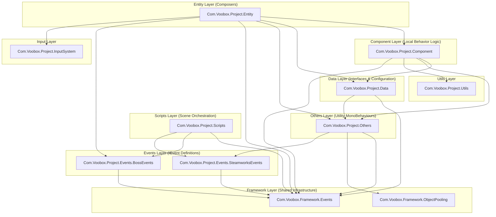

# Architecture Source of Truth (SoT) — Empress Project

> **Authority**: Absolute Single Point of Reference for Project Architecture & Implementation  
> **Status**: Active Standard  
> **Target Engine**: Unity 6 (`6000.3.10f1`)  
> **Project**: Empress — 2D Side-Scrolling Action-Platformer  
> **Pattern**: Composition + Event-Driven Mediation (Custom ECS-Inspired)

---

## 1. Core Architectural Pattern: Composition + Event-Driven Mediation

This project uses a custom, ECS-inspired architecture—**distinct from Unity's native DOTS package**—structured around three collaborating layers:

```mermaid
flowchart TD
    subgraph ComposerLayer["Composers (Entities)"]
        direction TB
        HC["HeroComposer"]
        BC["BossComposer"]
        BAE["BossAttackEmitter"]
    end

    subgraph ComponentLayer["Components (Local Logic Handlers)"]
        direction TB
        M2D["Movement2DComponent"]
        DC["DasherComponent"]
        AC["AttackerComponent"]
        HAC["HeroAnimatorComponent"]
        FFC["FrameFreezerComponent"]
        SSC["ScreenShakerComponent"]
    end

    subgraph DataLayer["Data (Interfaces + ScriptableObjects)"]
        direction TB
        IMove["IMovementData"]
        IDash["IDasherData"]
        IAtk["IAttackerData"]
        IShk["IScreenShakerData"]
        HD["HeroData"]
        HDSO["HeroDataScriptableObject"]
    end

    subgraph EventLayer["EventBus (Cross-Entity Mediation)"]
        direction TB
        EB["EventBus (static)"]
        IBE["InitializeBossEvent"]
        DRS["DoRaiseOfSwordsEvent"]
        ISE["InitializeSteamworksEvent"]
    end

    HC -->|creates & orchestrates| M2D
    HC -->|creates & orchestrates| DC
    HC -->|creates & orchestrates| AC
    HC -->|creates & orchestrates| HAC
    HC -->|creates & orchestrates| FFC
    HC -->|creates & orchestrates| SSC

    M2D -->|reads config from| IMove
    DC -->|reads config from| IDash
    AC -->|reads config from| IAtk
    SSC -->|reads config from| IShk

    HD -->|implements| IMove
    HD -->|implements| IDash
    HD -->|implements| IAtk
    HD -->|implements| IShk
    HDSO -->|wraps| HD

    BC -->|subscribes to| IBE
    BC -->|emits| DRS
    BAE -->|subscribes to| DRS
```



### 1.1 Composers (Entities)
* **Role**: Represent core game entities. They hold entity state flags, define execution conditions, and orchestrate which local Components participate in an operation.
* **Pattern**: `MonoBehaviour` on the root GameObject. Creates plain C# Component instances in `Awake()` via constructor injection of data interfaces.
* **Cross-Entity Rule**: When an action requires interaction beyond the local entity, the Composer emits an event through `EventBus.Notify<T>()`.
* **Current Composers**: `HeroComposer`, `BossComposer`, `BossAttackEmitter`.

### 1.2 Components (Local Logic Handlers)
* **Role**: Implement modular behavioral operations that act directly upon their parent Entity (Composer). They are **not** passive data containers—they execute atomic behaviors.
* **Pattern**: Plain C# classes (not MonoBehaviours) receiving data interfaces via constructor. They do **not** subscribe to the EventBus or interact with other entities directly.
* **Current Components**: `Movement2DComponent`, `DasherComponent`, `AttackerComponent`, `HeroAnimatorComponent`, `FrameFreezerComponent`, `ScreenShakerComponent`.

### 1.3 Systems (Cross-Entity Mediators via EventBus)
* **Role**: The `EventBus` acts as the bridge for operations that start in one Entity and end in another. Composers subscribe to events and notify events.
* **Pattern**: Static `EventBus.Subscribe<T>(callback)` / `EventBus.Notify<T>(eventArgs)` where `T : IEvent`.
* **Current Event Flow**:
  - `BossSceneScript` → emits `InitializeBossEvent` → `BossComposer` receives → emits `DoRaiseOfSwordsEvent` → `BossAttackEmitter` receives and triggers attack animation.
  - `BossSceneScript` → emits `InitializeSteamworksEvent` → `PlaceSteamName` receives and displays Steam username.

---

## 2. Assembly Definitions (`.asmdef`) Boundary Map

All project code is organized into explicit `Com.Voobox.*` assemblies. Direct loose script coupling is prohibited.



### Dependency Rules
* **Zero Circular Dependencies**: Assemblies must follow a strict one-way dependency graph.
* **Framework has no project dependencies**: `Com.Voobox.Framework.*` assemblies depend on nothing project-specific.
* **Events depend only on Framework.Events**: Event definition assemblies reference only `Com.Voobox.Framework.Events` (for the `IEvent` interface).
* **Components depend on Data + Utils**: Components read data through interfaces but never reference Entity/Composer assemblies.
* **Entities depend on Components + Data + Events**: Composers wire everything together; they are the only layer that can reference both Components and Events.

---

## 3. Data Architecture

### 3.1 Data Interface Pattern
Components receive configuration through interfaces, not concrete classes:

| Interface | Consuming Component | Properties |
| :--- | :--- | :--- |
| `IMovementData` | `Movement2DComponent` | Speed, JumpForce, JumpBufferTime, RecoilBackForce, RecoilUpForce, RecoilDuration, SFXJumpEventReference, Rigidbody2D |
| `IDasherData` | `DasherComponent` | DashForce, DashDuration, DashCooldown, SFXDashEventReference, Rigidbody2D |
| `IAttackerData` | `AttackerComponent` | AttackDuration, AttackUp/Down/Left/Right (AttackArea references) |
| `IScreenShakerData` | `ScreenShakerComponent` | SmoothSpeed, ScreenShakeForce, ScreenShakeDirection, ImpulseSource, PositionComposer, Rigidbody2D |

### 3.2 ScriptableObject Data Containers
* `HeroDataScriptableObject` → wraps `HeroData` (which implements all four data interfaces).
* `BossDataScriptableObject` → wraps `BossData` (currently empty / stub).
* Composers clone the SO at runtime via `Instantiate()` to allow per-instance mutation without corrupting the asset.

---

## 4. Event Architecture

### 4.1 EventBus Contract
```csharp
// Framework: Com.Voobox.Framework.Events
public static class EventBus
{
    public static void Subscribe<T>(Action<T> callback) where T : IEvent;
    public static void Unsubscribe<T>(Action<T> callback) where T : IEvent;
    public static void Notify<T>(T eventArgs) where T : IEvent;
}
public interface IEvent { }
```

### 4.2 Current Events Registry

| Event Class | Assembly | Emitter | Subscriber(s) |
| :--- | :--- | :--- | :--- |
| `InitializeBossEvent` | `Com.Voobox.Project.Events.BossEvents` | `BossSceneScript.Start()` | `BossComposer.InitializeBoss()` |
| `DoRaiseOfSwordsEvent` | `Com.Voobox.Project.Events.BossEvents` | `BossComposer.InitializeBoss()` | `BossAttackEmitter.DoRaiseOfSwords()` |
| `InitializeSteamworksEvent` | `Com.Voobox.Project.Events.SteamworksEvents` | `BossSceneScript.Start()` | `PlaceSteamName.OnInitializeSteamworks()` |

### 4.3 Rules for New Events
1. Create a new class implementing `IEvent` in the appropriate `Events/` subdirectory with its own `.asmdef`.
2. The `.asmdef` must reference only `Com.Voobox.Framework.Events`.
3. Emitters call `EventBus.Notify<T>(new T())` — typically from a Composer or Scene Script.
4. Subscribers call `EventBus.Subscribe<T>(handler)` in `Awake()` and `EventBus.Unsubscribe<T>(handler)` in `OnDestroy()`.

---

## 5. Coding & Performance Constraints

### Zero Garbage Collection (GC) in Hot Paths
* **Update Loops**: No heap allocations inside `Update()`, `FixedUpdate()`, or `LateUpdate()`.
  * **Prohibited in loops**: `new` (except value types), string formatting/concatenation, LINQ queries (`.Where()`, `.Select()`), lambda allocations, boxing.
  * **Collections**: Pre-allocate and reuse persistent lists/buffers; pass buffers as arguments using `List<T>.Clear()` or `Span<T>`.

### Component & Memory Caching
* **Component References**: Never call `GetComponent<T>()`, `FindObjectOfType<T>()`, or access `Camera.main` inside repetitive methods or update loops.
* **Initialization**: Cache all references during `Awake()` or `OnEnable()`.
* **String/Name Hashing**: Use `Animator.StringToHash()` for animation parameters (as seen in `HeroAnimatorComponent`).

### Object Lifecycle & Pooling
* **Spawning Policy**: Instantiating and destroying GameObjects dynamically at runtime is prohibited for frequently used entities (projectiles, VFX impacts, damage numbers).
* **Pooling Standard**: Use the project's `ObjectPooler` (Addressables-based pool at `Com.Voobox.Framework.ObjectPooling`).

### Async Pattern
* **UniTask**: All async operations use Cysharp UniTask, never `System.Threading.Tasks.Task` or coroutines for new code.
* **Cancellation**: Use `TaskHandle` for cancellable async operations. Call `GetNewToken()` to auto-cancel previous operations.
* **Fire-and-Forget**: Use `.Forget()` for UniTaskVoid or when the caller does not need to await completion.

---

## 6. Naming & Structural Conventions

| Element | Convention | Example |
| :--- | :--- | :--- |
| **Namespaces** | `Com.Voobox.{Layer}.{Area}` | `Com.Voobox.Project.Component` |
| **Assemblies** | `Com.Voobox.{Layer}.{Area}` (matching namespace) | `Com.Voobox.Project.Entity` |
| **Composer Classes** | `{Entity}Composer` | `HeroComposer`, `BossComposer` |
| **Component Classes** | `{Behavior}Component` | `Movement2DComponent`, `AttackerComponent` |
| **Data Interfaces** | `I{Behavior}Data` | `IMovementData`, `IDasherData` |
| **Data Classes** | `{Entity}Data` | `HeroData`, `BossData` |
| **ScriptableObject Wrappers** | `{Entity}DataScriptableObject` | `HeroDataScriptableObject` |
| **Event Classes** | `{Action}Event` | `InitializeBossEvent`, `DoRaiseOfSwordsEvent` |
| **Private Fields** | `m_camelCase` | `m_heroData`, `m_rigidbody2D` |
| **Private Serialized Fields** | `m_camelCase` with `[SerializeField]` | `[SerializeField] private float m_attackDuration;` |
| **Constants** | `UPPER_SNAKE_CASE` | `RAISE_OF_SWORDS_LEFT_ATTACK` |
| **Properties** | `PascalCase` | `IsJumpBufferActive`, `AttackDuration` |

---

## 7. Directory Anchor Points

| Directory | Purpose |
| :--- | :--- |
| `Assets/_Project/Source/Framework/Events/` | `EventBus` and `IEvent` interface |
| `Assets/_Project/Source/Framework/ObjectPooling/` | Addressables-based `ObjectPooler`, `PooledObject`, `ReturnToPoolBehaviour` |
| `Assets/_Project/Source/Project/Component/` | All Component classes (plain C# behavior handlers) |
| `Assets/_Project/Source/Project/Data/` | `HeroData`, `BossData`, ScriptableObject wrappers |
| `Assets/_Project/Source/Project/Data/Interfaces/` | `IMovementData`, `IDasherData`, `IAttackerData`, `IScreenShakerData` |
| `Assets/_Project/Source/Project/Entity/` | `HeroComposer`, `BossComposer`, `BossAttackEmitter` |
| `Assets/_Project/Source/Project/Events/BossEvents/` | `InitializeBossEvent`, `DoRaiseOfSwordsEvent` |
| `Assets/_Project/Source/Project/Events/SteamworksEvents/` | `InitializeSteamworksEvent` |
| `Assets/_Project/Source/Project/Others/` | `AttackArea`, `PlaceSteamName` |
| `Assets/_Project/Source/Project/Scripts/` | `BossSceneScript` (scene lifecycle orchestration) |
| `Assets/_Project/Source/Project/Utils/` | `TaskHandle` (cancellation token management) |
| `Assets/_Project/Prefabs/Units/` | `Hero.prefab`, `Boss.prefab` |
| `Assets/_Project/Prefabs/Projectiles/` | `BigSword.prefab`, `BossAttackEmitter.prefab` |
| `Assets/_Project/Prefabs/VFXs/` | `VFX_Hit_01.prefab` |
| `Assets/_Project/Prefabs/SceneSettings/` | Camera, Light, Background, Stage, Settings prefabs |
| `Assets/_Project/Scenes/` | `BossScene.unity` (single active scene) |
| `Assets/_Project/ScriptableObject/` | `HeroData.asset` |
| `Assets/_Project/InputSystem/` | Generated `InputSystemActions` from Unity Input System |
| `Assets/Editor/AgentAutomation/` | Agent batch automation scripts (for headless scene/prefab ops) |
| `Assets/Tests/EditMode/` | NUnit EditMode unit test fixtures |
| `Assets/Tests/PlayMode/` | NUnit PlayMode integration test fixtures |
