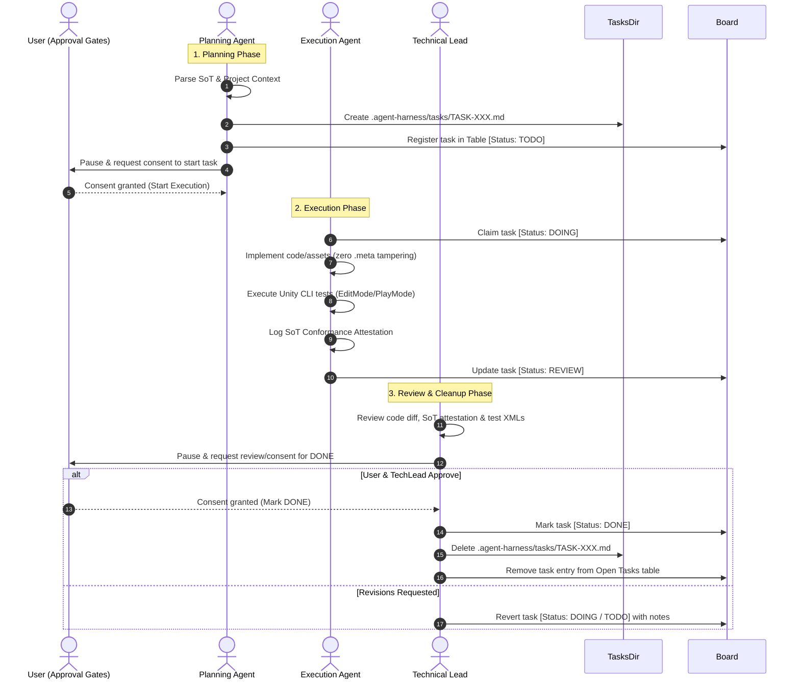

# Agent Tasks Board & Multi-Agent Hand-off

> **Status**: Active Central Board  
> **Directory**: `.agent-harness/tasks/`  
> **Governance**: Governed by [`.agent-harness/agent-rules.md`](file:///.agent-harness/agent-rules.md)  
> **Project**: Empress — 2D Side-Scrolling Action-Platformer

---

## 1. Multi-Agent Hand-off Lifecycle



---

## 2. Task Status Definitions

| Status | Role Responsible | Description |
| :--- | :--- | :--- |
| **`TODO`** | Planning Agent → User | Specification written, validated against SoT, and **paused awaiting user consent** before starting execution. |
| **`DOING`** | Execution Agent | User consented; task claimed and code/assets actively being modified and tested via CLI. |
| **`REVIEW`** | Execution → Tech Lead → User | Changes committed and CLI tests passed cleanly; **paused awaiting user review & consent** to move to `DONE`. |
| **`DONE`** | Technical Lead (with User Consent) | Approved by User and Tech Lead. **Triggers immediate cleanup.** |

---

## 3. Open Tasks Register

<!-- 
NOTE: Only open tasks (TODO, DOING, REVIEW) reside here.
When a task transitions to DONE, delete its row from this table and remove its file from .agent-harness/tasks/.
-->

| ID | Task Name | Status | File Path |
| :--- | :--- | :--- | :--- |
| *None* | *No active tasks pending* | - | - |

---

## 4. Task Specification Template

All task specification files inside `.agent-harness/tasks/` must be cloned directly from [`.agent-harness/task.template.md`](file:///.agent-harness/task.template.md).

```markdown
# TASK-XXX: [Task Title]

* **ID**: TASK-XXX
* **Status**: TODO
* **Target Engine**: Unity 6 (6000.3.10f1)
* **Target Platform**: StandaloneWindows64

## 1. Objective
[1-2 sentences describing the exact goal and expected outcome.]

## 2. Target File Paths
### Existing Files to Modify
* `Assets/_Project/Source/Project/...` - [Role of modification]

### New Files to Create
* `Assets/_Project/Source/Project/...` - [Role of new file]

## 3. Context & Architectural Constraints
* **Assembly Definition**: `[e.g., Com.Voobox.Project.Component]`
* **Composition Pattern**: `[e.g., Plain C# Component injected into Composer with IDataInterface]`
* **Event Pattern**: `[e.g., EventBus.Notify<T>() / EventBus.Subscribe<T>()]`
* **Performance / GC**: `[Zero heap allocations in Update(), cached component refs]`

## 4. Execution & Unity CLI Steps
1. [Implementation step-by-step]
2. [CLI recompile & test runner commands]

## 5. Definition of Done (Acceptance Criteria)
- [ ] Explicit checklist of verifiable conditions before moving to REVIEW
```

---

## 5. Cleanup Protocol

* **Rule**: Completed tasks must not clutter repository history or context windows.
* **Trigger**: When the Technical Lead marks a task as **`DONE`**:
  1. Remove the task row from the [Open Tasks Register](#3-open-tasks-register) above.
  2. Permanently delete the corresponding `.agent-harness/tasks/TASK-XXX-name.md` file.
  3. Evaluate if changes necessitate updating [`.agent-harness/project-context.md`](file:///.agent-harness/project-context.md).
